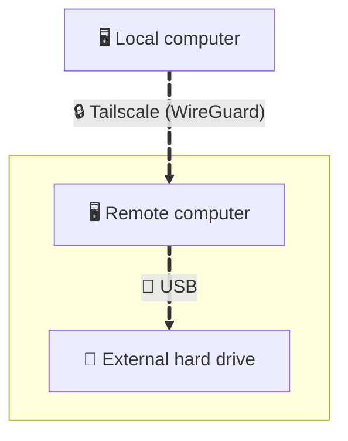

The [3-2-1 Backup Strategy](https://www.backblaze.com/blog/the-3-2-1-backup-strategy/) says keep at least one copy offsite. A cloud service sounds like the right approach, but comes with drawbacks. So... let's find another way.

<!--more-->

# Drawbacks?
Backing up data using a cloud service sounds good in the short term, but less in the long run.

- The obvious first reason is the cost. Not a huge one, but still a monthly one. Over time, it becomes (very) expensive, especially for a service that sits idle most of the time. There exist lifetime plans out there, for which you pay only once, but they are far from cheap.
- A second reason is privacy. By relying on a cloud service, you trust that they will keep your files away from anybody: because that's the only thing you can do. Indeed, as soon as your files live on hardware you don't own, you lose control over who has real access.
- Finally, a third reason is vendor lock-in. The more the amount of backed-up data increases, the harder it gets to download all of it. Good luck exporting a 2 TB archive without paying a bandwidth penalty.

What about using a machine you own for a distant backup?

# We need someone to lean on 🎶
If you think of a cloud provider as a computer running remotely, then everyone you (deeply) trust becomes a potential cloud provider. All they have to do is wire your machine to their router so that you can connect to it. That's as simple as it gets! Right?

Well, there is a catch. Connecting to a remote machine behind a consumer router is not straightforward. It requires port forwarding on their router, and you need to adapt to their router IP changes. There is also this small, unpleasant feeling that you might have opened a hole in their firewall.

I don't like all this hassle. Can we get rid of it?

# Tailscale for the win
[Tailscale](https://tailscale.com/) is a mesh VPN. It creates a private, encrypted network between your own devices, and makes them behave as if they're plugged into the same switch, except they're not. They could be in different cities, behind different routers, on different ISPs, it doesn't matter: you can talk to them. Furthermore, each device is assigned a stable `100.X.X.X` IP address that never changes. This sounds like the perfect solution to reach the remote machine! There is just one last concern: privacy. Do Tailscale servers see the traffic between devices?

The answer is no. Tailscale servers only know which devices belong to you and exchange public keys so they can find each other. Once devices have each other's public keys, they open a [WireGuard](https://www.wireguard.com/) tunnel directly between themselves (at worst relayed through a Tailscale node, which still only sees encrypted packets). No third party sits in the middle.

Now that we have all we need (that is: a trusted peer, a machine connected to their router, and a way to reach it), let's wire it up!

# Setting up the backup
Summing up, here's how the backed-up data will flow:


The first step is to install then run Tailscale on both computers:
```bash
curl -fsSL https://tailscale.com/install.sh | sh
sudo tailscale up
```
In each case you will be given a link to log into your Tailscale account from a browser, then asked to add the device to your tailnet. That's... it. Network configuration is done. You should now see your computers and their respective IPs when running the command
```bash
tailscale status
```
The second step is to configure the data transfer. I simply use an `rsync` command over `ssh` to synchronize a local directory to a remote one:
- On the remote computer, create a user, e.g. `backup-user`, then mount the external drive on your favorite directory, e.g. `/remote-dir`. Give `backup-user` permission to write in it.
- On the local computer, create an `ssh` key:
  ```bash
  ssh-keygen -t ed25519 -f ~/.ssh/id_ed25519_backup -C "backup"
  ```
- Copy the key to the remote computer:
  ```bash
  # a one-line command (replace 100.X.X.X with remote computer tailscale IP)
  cat ~/.ssh/id_ed25519_backup.pub | ssh backup-user@100.X.X.X 'mkdir -p ~/.ssh && cat >> ~/.ssh/authorized_keys && chmod 700 ~/.ssh && chmod 600 ~/.ssh/authorized_keys'

  # now key-based ssh login should work:
  ssh -i ~/.ssh/id_ed25519_backup backup-user@100.X.X.X
  ```
- Run the backup using an `rsync` command:
  ```bash
  rsync -avz --partial --no-g --no-o -e "ssh -i ~/.ssh/id_ed25519_backup" /local-dir backup-user@100.X.X.X:/remote-dir >> ~/backup.log 2>&1
  ```
- Run it when you feel like it, or preferably, schedule its execution on a regular basis, e.g. via a `cron` job.

# Tips
- I suggest the use of an external hard drive for storage because it makes it very easy to transfer large amounts of data from one place to another when you need it. Beware that making the data easily removable also means it is easier for anyone to take it --- that's the responsibility of the person you trust.
- Beware of large data transfers that go through both routers, especially the first time. Consider a first run of the backup within your local network.
- In the `rsync` command, 
  - the optional `--size-only` flag simplifies file comparison by only considering the size. However, this means that edits resulting in the same file size will be skipped;
  - the optional `--dry-run` flag helps preview which files and how much data would be transferred, without actually copying anything.

Last but not least: live in peace with a synchronized copy of your data now living offsite with someone you trust. 🌈