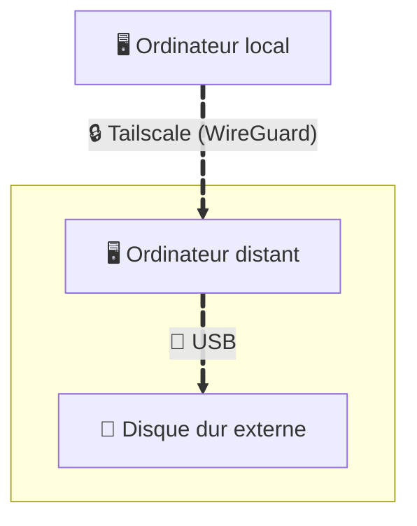

La [règle 3-2-1 ](https://www.backblaze.com/blog/the-3-2-1-backup-strategy/) pour les sauvegardes recommande de conserver au moins une copie des données hors-site. Un service cloud semble la solution idéale, mais présente des inconvénients. Faisons autrement.

<!--more-->

# Des inconvénients?
Sauvegarder ses données dans le cloud semble être une bonne idée à court terme, mais c'est moins le cas à long terme.

- La première raison, la plus évidente, est le coût. Pas énorme, mais mensuel. Avec le temps, cela devient (très) coûteux, surtout pour un service qui reste inactif la majeure partie du temps. Il existe des abonnements à durée illimitée, pour lesquels on ne paie qu'une seule fois, mais ils sont loin d'être abordables.
- La deuxième raison est la confidentialité. En s'appuyant sur un service cloud, la garde des fichiers est déléguée à un système tiers sur lequel vous n'avez aucun contrôle sur l'accès réel.
- Enfin, une troisième raison: l'enfermement propriétaire (*vendor lock-in*). Plus les données sauvegardées s'accumulent, plus il devient difficile de tout réexporter. Bonne chance pour téléchargeer une archive de 2 To sans payer de pénalité de bande passante...

Pourquoi ne pas utiliser du matériel dont vous êtes propriétaire pour une sauvegarde distante?

# *We need someone to lean on* 🎶
Si l'on considère un fournisseur cloud comme un ordinateur qui tourne à distance, alors chaque personne de votre entourage en qui vous avez (très) confiance devient un possible fournisseur cloud. Il leur suffit de connecter votre machine à leur routeur et le tour est joué. C'est aussi simple que ça, n'est-ce pas?

Oui et non. Se connecter à une machine distante derrière un routeur dans un réseau public n'est pas trivial. Cela exige une redirection de port sur leur routeur, et il faut s'adapter aux changements d'adresse IP de celui-ci. S'y ajoute ce petit sentiment désagréable d'avoir peut-être ouvert un trou dans un pare-feu.

Je n'aime pas toutes ces complications. Peut-on s'en passer?

# Tailscale, sans discussion
[Tailscale](https://tailscale.com/) est un VPN maillé. Il crée un réseau privé et chiffré entre vos propres appareils, et les fait se comporter comme s'ils étaient branchés sur le même switch, sauf qu'ils ne le sont pas. Ils peuvent se trouver dans des villes différentes, derrière des routeurs différents, chez des opérateurs différents, peu importe: vous pouvez communiquer avec eux. De plus, chaque appareil se voit attribuer une adresse IP stable `100.X.X.X` qui ne change jamais.  Ça semble être la solution parfaite pour atteindre la machine distante! Il ne reste qu'une dernière préoccupation: la confidentialité. Les serveurs de Tailscale voient-ils le trafic entre les appareils?

La réponse est non. Les serveurs de Tailscale ne font que que connaître vos appareils et échanger leurs clés publiques afin qu'ils puissent se trouver. Une fois que chaque appareil connaît la clé publique de l'autre, ils ouvrent un tunnel [WireGuard](https://www.wireguard.com/) directement entre eux (au pire relayé via un nœud Tailscale, qui ne voit alors que des paquets chiffrés). Aucun tiers ne se trouve au milieu.

Maintenant que tout est réuni (à savoir: une personne de confiance, une machine connectée à leur routeur, et un moyen de l'atteindre), mettons tout en place!

# Configuration de la sauvegarde distante
Pour résumer, voici comment les données sauvegardées vont circuler:


La première étape consiste à installer puis lancer Tailscale sur les deux ordinateurs:
```bash
curl -fsSL https://tailscale.com/install.sh | sh
sudo tailscale up
```
Dans chaque cas, un lien vous sera fourni pour vous connecter à votre compte Tailscale depuis un navigateur, puis vous serez invité à ajouter l'appareil à votre tailnet. C'est... tout. La configuration réseau est terminée. Vous devriez maintenant voir vos ordinateurs et leurs adresses IP respectives en exécutant la commande
```bash
tailscale status
```
La seconde étape consiste à configurer le transfert des données. J'utilise simplement une commande `rsync` en `ssh` pour synchroniser un dossier local vers un dossier distant:
- Sur l'ordinateur distant, créez un utilisateur, par exemple `backup-user`, puis montez le disque externe dans un dossier de votre choix, par exemple `/remote-dir`. Accordez à `backup-user` la permission d'y écrire.
- Sur l'ordinateur local, créez une clé `ssh`:
  ```bash
  ssh-keygen -t ed25519 -f ~/.ssh/id_ed25519_backup -C "backup"
  ```
- Copiez la clé vers l'ordinateur distant:
  ```bash
  # une seule commande (remplacez 100.X.X.X par l'adresse IP Tailscale de l'ordinateur distant)
  cat ~/.ssh/id_ed25519_backup.pub | ssh backup-user@100.X.X.X 'mkdir -p ~/.ssh && cat >> ~/.ssh/authorized_keys && chmod 700 ~/.ssh && chmod 600 ~/.ssh/authorized_keys'

  # la connexion ssh par clé devrait maintenant fonctionner:
  ssh -i ~/.ssh/id_ed25519_backup backup-user@100.X.X.X
  ```
- Lancez la sauvegarde à l'aide d'une commande `rsync`:
  ```bash
  rsync -avz --partial --no-g --no-o -e "ssh -i ~/.ssh/id_ed25519_backup" /local-dir backup-user@100.X.X.X:/remote-dir >> ~/backup.log 2>&1
  ```
- Exécutez-la quand bon vous semble, ou, mieux encore, planifiez son exécution à intervalle régulier, par exemple via une tâche `cron`.

# Conseils
- Je recommande l'utilisation d'un disque dur externe pour le stockage distant, car il rend très facile le transfert de grandes quantités de données d'un endroit à un autre lorsque c'est nécessaire. Attention, toutefois: rendre les données facilement déplaçables signifie aussi qu'elles sont plus faciles à prendre --- c'est la responsabilité de la personne en qui vous avez confiance.
- Méfiez-vous des grands transferts de données traversant les deux routeurs, surtout la première fois. Faites la première sauvegarde dans votre réseau local pour éviter une mauvaise surprise de consommation.
- Dans la commande `rsync`,
  - l'option `--size-only` simplifie la comparaison des fichiers en ne tenant compte que de leur taille. Attention que les modifications aboutissant à la même taille de fichier sont alors ignorées;
  - l'option '`--dry-run` permet d'apercevoir quels fichiers et quelle quantité de données seront transférés, sans rien copier réellement.

Dernier point, mais non des moindres: vivez en paix en sachant qu'une copie synchronisée de vos données est désormais hébergée hors-site, chez quelqu'un en qui vous avez confiance. 🌈